# 🎛️ New Hera-nux

> The **Hercules Stream 100** on **Linux**: userspace drivers, a companion app, an open API with
> modules, and a custom firmware that turns its screen into a real canvas.

🇫🇷 [Version française](README_FR.md)

**Contents:** [About](#-about) · [Screenshots](#-screenshots) · [Features](#-features) · [Modules](#-modules) · [How to install](#-how-to-install) · [Repository layout](#-repository-layout) · [Status](#-status) · [Behind the project](#-behind-the-project) ([why a custom firmware](#-why-a-custom-firmware), [a learning project](#-a-learning-project), [pitfalls](#-pitfalls-we-fell-into), [the name](#-the-name)) · [Legal notice](#-legal-notice) · [Disclaimer](#-disclaimer)

---

## 🎯 About

The Hercules Stream 100 (`06f8:e053`) is a stream controller: 4 endless knobs, 4 buttons + power,
4 LEDs and a 480×272 colour screen. Hercules only ships **Stream Control**, a Windows application
that talks to the device through **Windows kernel drivers**, so it does not run under Wine or
Proton. On Linux, the device was a dead brick. 🧱

This project makes it **fully usable on Linux**, and goes further than the original software:

- 🦀 **Userspace drivers** in **Rust** and **C** (libusb, no kernel module), at parity, with the
  same test vectors and a GitHub release workflow for each.
- 🖥️ **New Hera-nux**, the companion app: pages of free widgets (texts, images, VU meters, gauges,
  spectrum analyser…), per-app audio mixer through PipeWire, knobs and buttons bound to actions,
  desktop notifications, standby, and a live editor window.
- 🔌 **An open API** (Unix socket + local WebSocket, JSON, Python client) and **modules** that
  draw their own pages: Discord 🎧, Spotify 🎵, OBS 🎬, Motor Town and SimHub 🏎️, live scores ⚽, system
  monitoring 🌡️, stream deck, media player…
- ⚙️ **A custom firmware** for the device's STM32L4R7, written in Rust (embassy).

Everything was understood from the device itself and the official software, by **reverse
engineering with Ghidra** and USB captures, and is documented step by step in [`docs/`](docs/README.md).

## 📸 Screenshots

What the Stream 100's screen shows (480×272, rendered by the app; test data and simulated audio).

| | |
|:---:|:---:|
| 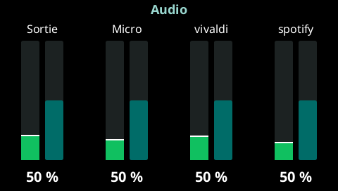<br>🔊 **Audio page**: name, VU meter and volume of 4 targets | 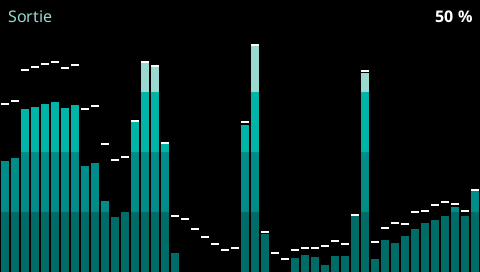<br>📈 **Visualiser**: spectrum analyser |
| 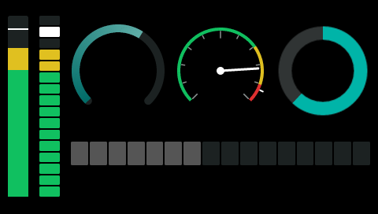<br>🎚️ **Gauges**: bar, LED segments, arc, needle, ring, steps | 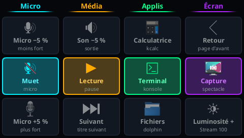<br>🟦 **Stream deck**: 4 tracks of tiles, one per knob |
| 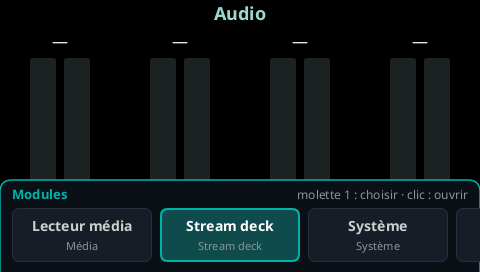<br>🧩 **Module menu** (hold knob 1) | 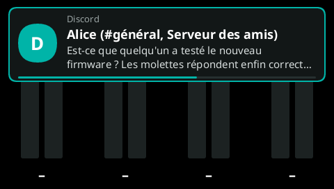<br>🔔 **Desktop notification** (Discord) |
| 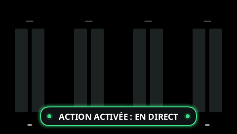<br>💊 **Pill**: short animated banner | 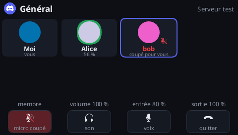<br>🎧 **Discord**: voice channel, mute, volumes |
| 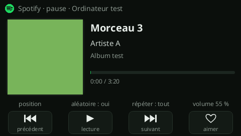<br>🎶 **Spotify**: track, cover, controls | 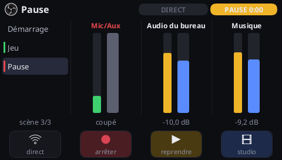<br>🎬 **OBS**: scenes, mixer and meters, stream / recording |
| 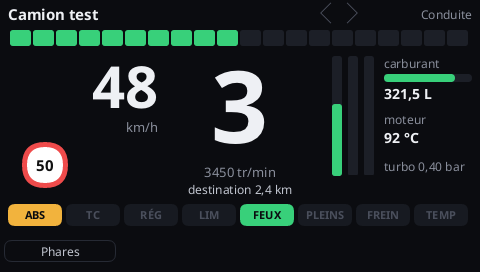<br>🏎️ **Motor Town**: driving screen | 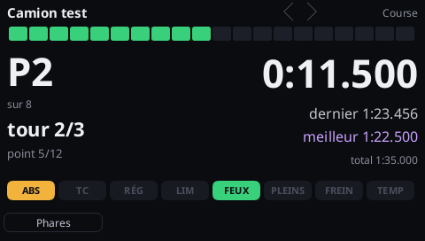<br>🏁 **Motor Town**: race screen |
| 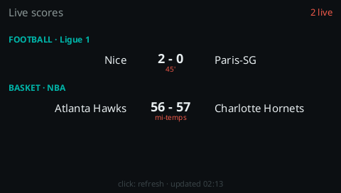<br>⚽ **Live scores**: matches under way, by sport | 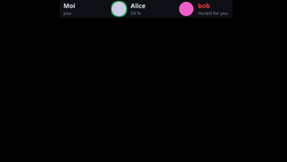<br>🎧 **Discord widget** in a row, scrolling sideways in a 30 px band |
| 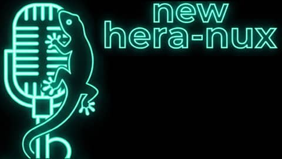<br>🚀 **Boot logo** of the custom firmware | 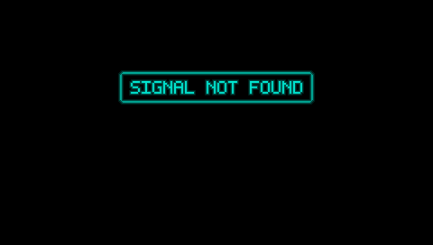<br>🛰️ **SIGNAL NOT FOUND**: the custom firmware's saver when the computer stops (at 1 % backlight on the device) |

## ✨ Features

### 🖥️ The app: New Hera-nux
- **Pages of free widgets**: texts (variables, gradients, auto-scrolling when too long), rectangles,
  images (PNG, JPEG…), desktop-theme icons, separators (plain, dashed, dotted, fading), frames with
  chosen borders, VU meters and volume gauges (bar, LED segments, arc, needle, custom images),
  spectrum analyser (FFT), module pages and widgets, stream-deck tracks.
- **Page backgrounds**: colour, gradient, picture or animated GIF, with darkening.
- **Live editor window**: preview of the device screen, drag and resize with the mouse, 16 px grid
  and magnets, multi-selection, align / distribute, keyboard moves, undo / redo, save with Ctrl+S.
- **Colour calibration** with a test chart, brightness, [standby](#-standby).
- **English or French** (Device tab), from translation files: a language can be added without
  rebuilding, and modules follow with their own files. 🌍
- **Colour emoji**, system fonts, tray icon, single instance, headless mode (service),
  `--snapshot` to render a page as PNG without the device.

### 🔊 Audio and media
- Per-knob **audio targets**: default output, default input, any output or input, **any
  application** (Firefox, Spotify, a game…), the **full-screen application** (games), or a module
  command.
- Volume and mute through **PipeWire** (PulseAudio API), live peak meters at 60 Hz.
- **Media players** (MPRIS): play / pause, next, previous, seek.

### 🎛️ Knobs, buttons and LEDs
- Every knob turn and click, every button **press, hold and click** (power included) can run an
  **action**: mute, shell command, open a URL, **keyboard shortcut** (virtual keyboard), media
  control, next / previous / chosen page, show a module, **module menu**, module command, back,
  brightness (cycle, set, up, down).
- Knob sensitivity, hold delays, a confirmation step for volumes over 100 %.
- **LEDs**: off, on, follow a mute state, or a module command's state.

### 🔔 Notifications
- **Desktop notifications** (D-Bus) shown on the device, filtered by application, avatar and
  emoji included; a click closes them.
- **Alerts** and animated **pills** from modules or the shell (`hsm01ctl alert …`); one per
  application in the queue.

### 💤 Standby
- **Screen standby** after a while with no action (5 minutes by default, set in the **Device**
  tab): the backlight fades out, then the screen and LEDs turn off.
- **Wake-up** with any knob or button (that first touch does not run its action), or with a
  notification if you wish.
- **No standby while a module is on screen**: each module has a « no standby while it is
  shown » box (OBS during a stream, a game dashboard…): the screen stays on while its page or
  one of its widgets is shown, and standby comes back on the other pages.
- **Modules loaded only when shown** (by default): a module starts only when the screen needs
  it (its page opened from the modules menu, its widget, a knob, LED or button tied to its
  commands on the page shown), is frozen a few seconds after it leaves the screen and stopped
  after 30 s. Untick « load only when shown » on its card for a module that must work in the
  background (Discord's join / leave pills, alerts of the system sensors…).
- **App closed** (Quit, end of session, PC shutdown): the device turns off cleanly.
- **PC asleep** (custom firmware): screen and LEDs turn off with it, and come back on wake-up.
- **App crashed or gone** (custom firmware): the « SIGNAL NOT FOUND » screen saver at 1 %
  backlight, then the screen turns off after 5 minutes. 🛰️

### 🔌 Open API
- Unix socket and **local WebSocket** with a token (web pages can use it), JSON messages.
- Pages, widgets, alerts, pills, LEDs, input events, grabbing inputs, commands, settings-form
  lists, media control; **Python client** included, any language works.

### ⚙️ Custom firmware (240.xx)
- Free 480×272 framebuffer: fill, blit, RLE blit, **copy** (hardware-assisted scrolling), about
  **936 KiB/s** over USB bulk.
- Raw dual-wiper knob readings every 10 ms, buttons, backlight and LEDs **0-100 %** (PWM).
- Animated **boot logo**, **"SIGNAL NOT FOUND"** saver when the computer stops, then screen off.
- **DFU recovery hatch** first (USB request or knob clicks 1 + 4); the last flash page (serial
  number) is never touched.

### 🦀 Drivers (Rust and C)
- The **whole original protocol**: framing and CRC16, every command, RLE icons and labels, VU
  meters, LEDs, 256-colour backgrounds (same results in Rust and C), boot logo, input reports.
- The custom firmware's protocol.
- Command-line tools `hsm01` / `hsm01-c`: `info`, `monitor`, `demo`, `brightness`, `led`,
  `background`, `splash`, `fw …` (PNG, JPEG, GIF, BMP pictures).
- Tests on captured frames, GitHub releases for x86_64 and aarch64, udev rule.

## 🧩 Modules

Modules are small programs that extend New Hera-nux. Each one is a folder in
`~/.local/share/hsm01/modules/` with a `module.toml` and its program, written in **Python** (client
library provided) or in **any language** that speaks JSON over a Unix socket. Through the open
API, a module can:

- 🖼️ draw its own **pages** and **widgets** on the device, and update them live;
- 🎛️ react to the **knobs and buttons**, and offer **commands** you bind to any button or knob;
- 🔔 show **alerts** and **pills** (short animated banners);
- ⚙️ have its own **settings form** in the window, and keep its **secrets** (tokens, passwords)
  in its own `.env` file, readable by you only.

The app starts the modules you switch on, and restarts them if they stop, or when their code,
their settings or the app's language change. 🔄

### 📋 Shipped modules

Officially provided, in [`app/modules/`](app/modules/):

| Module | What it does |
|--------|--------------|
| 🎵 Media player | cover, title, artist, progress of the current player; controls; alert on track change |
| 🌡️ System | processor, memory, temperatures, disks, batteries; alerts with thresholds and durations |
| 📋 Shortcut menu | a grid menu of shortcuts on the screen |
| 🟦 Stream deck | 4 endless tracks of tiles, one per knob |
| 🎧 Discord | mute, deafen, volumes, voice channel members (avatars, who is speaking), favourite channels, per-member volume, "joined the channel" pills, members widget (column or row) |
| 🎶 Spotify | cover, like, shuffle, repeat, volume, track radio, favourite playlists, configurable buttons and knob clicks |
| 🎬 OBS | scenes, audio mixer with meters on the knobs, stream / recording (stop by holding), replay, virtual camera, studio mode, favourite sources / filters / media, "OBS state" widget |
| 🏎️ Motor Town, SimHub | game dashboard (revs, gear, speed, pedals, fuel, temperatures, lamps), race and vehicle screens, shift lights on the LEDs, pills, packet relay |
| ⚽ Live scores | matches under way from L'Équipe's live feed, by sport and competition; filter by sport, competition, team; read every minute while a match of the filter is on, otherwise every 5 minutes; page, widget, pill when a score changes |

### 🛠️ Make your own

In one click: **Modules** tab → « Create a module » gives a ready-to-edit template (a page, a
counter on knob 1, an alert on button 1, two commands, its English and French texts).
Everything a module can do is in the guide of the Python library they all use,
[`app/clients/python/README.md`](app/clients/python/README.md): pages and widgets, knobs and
buttons, alerts, commands, settings form, secrets, translations, ready-made helpers, testing.
Any other language works too: a module speaks JSON lines over a Unix socket
([`docs/app/api.md`](docs/app/api.md), in French 🇫🇷).

> ⚠️ **Modules from elsewhere.** A module is an ordinary program that runs with **your** rights:
> it can read and write your files, use the network, send keystrokes through the app… Only
> install modules you trust, and read their code first. 🔍 **I am not responsible for anything a
> module does or causes if it is not officially provided** with New Hera-nux (that is, not in
> `app/modules/` of this repository).

## 📦 How to install

> ⏱️ About 15 minutes. Follow the steps **in order**, from the root of the repository, and
> **never skip the backup** 💾: it is your only way back to the original firmware.

### 1. 🧰 Prerequisites

```sh
# Debian / Ubuntu
sudo apt install build-essential pkg-config libusb-1.0-0-dev libpulse-dev llvm dfu-util python3-usb cmake
# Arch / Manjaro
sudo pacman -S base-devel pkgconf libusb libpulse llvm dfu-util python-pyusb cmake
# Rust (https://rustup.rs) and the target of the device's microcontroller
rustup target add thumbv7em-none-eabihf
```

### 2. 🔑 Access without root

The rule covers the device and its DFU mode (`0483:df11`), so nothing below needs `sudo`.
```sh
sudo cp packaging/udev/70-hercules-stream100.rules /etc/udev/rules.d/
sudo udevadm control --reload && sudo udevadm trigger
```
Then unplug and plug the Stream 100 back in. 🔌

### 3. 💾 Back up the original firmware (do not skip!)

Nothing is written to the device here: everything is **read**. The microcontroller has a **DFU
bootloader in ROM** (from ST, it cannot be erased); the backup goes through it.
```sh
mkdir -p backups/original && cd backups/original

# a. reboot the Stream 100 into its DFU bootloader
python3 -I ../../tools/hsm01_dfu_enter.py --yes      # or: hold knob clicks 1 + 4 while plugging it in
dfu-util -l                                           # must list 0483:df11

# b. check that the flash can be read (protection level)
dfu-util -d 0483:df11 -a 1 -s 0x1FF00000:64 -U ob_bank1.bin
dfu-util -d 0483:df11 -a 1 -s 0x1FF01000:64 -U ob_bank2.bin
python3 -I ../../tools/re/stm32l4_ob.py ob_bank1.bin ob_bank2.bin   # must say "-> level 0"

# c. read the whole flash (2 MiB) and the OTP area
dfu-util -d 0483:df11 -a 0 -s 0x08000000:0x200000 -U flash_full_backup.bin
dfu-util -d 0483:df11 -a 2 -s 0x1FFF7000:1024 -U otp.bin

# d. the file used to restore (start of the flash, covers any custom firmware) + checksums
head -c 262144 flash_full_backup.bin > restore_first_256k.bin
sha256sum *.bin | tee backup.sha256
cd ../..
```
- 🛑 If step **b** does not say `level 0`, **stop**: the flash is protected and cannot be backed up.
- 🗂️ Keep **copies** of `backups/original/` somewhere else (USB key, another disk), and check them
  later with `sha256sum -c backup.sha256`.
- 🔒 The backup contains the device's **serial number**: keep it private (`backups/` is ignored by git).
- `dfu-util -U` refuses to overwrite a file: delete the old one before running it again.

### 4. ⚙️ Build and flash the custom firmware

```sh
cd firmware/rust && cargo build --release
llvm-objcopy -O binary target/thumbv7em-none-eabihf/release/hsm01-fw hsm01-fw.bin
python3 -I ../../tools/re/fw_hatch_check.py target/thumbv7em-none-eabihf/release/hsm01-fw   # all "OK"
cd ../..

python3 -I tools/hsm01_dfu_enter.py --yes            # if the device is not in DFU mode any more
dfu-util -d 0483:df11 -a 0 -s 0x08000000 -D firmware/rust/hsm01-fw.bin
rm -f readback.bin                                     # read it back and compare
dfu-util -d 0483:df11 -a 0 -s 0x08000000:$(stat -c %s firmware/rust/hsm01-fw.bin) -U readback.bin
cmp firmware/rust/hsm01-fw.bin readback.bin && echo "READBACK OK"
dfu-util -d 0483:df11 -a 0 -s 0x08000000:leave       # start the new firmware
python3 -I tools/hsm01_whoami.py                       # must say "240.xx -> custom firmware"
```
`fw_hatch_check.py` checks that the DFU recovery hatch runs first and that the last flash page is
left alone: never flash a build that does not pass it.

### 5. 🖥️ Install New Hera-nux

The installer builds the app, installs it in your home (`~/.local/share/new-hera-nux/`), adds it
to the application menu, **starts it minimized in the system tray when your session opens**, and
starts it right away:
```sh
packaging/install.sh                  # from the source tree (needs Rust)
./install.sh                          # or from a release archive: new-hera-nux-<version>-<arch>.tar.gz
```
🔄 **Run it again to update**: the program is replaced, the app restarted, and your copies of the
shipped modules get their new code (your settings and secrets stay; `--keep-modules` leaves
them alone). Options: `--no-autostart`, `--no-udev`, `--no-start`, `--uninstall` (your settings
and modules stay); `--help` for all.

Without installing, straight from the build:
```sh
cd app && cargo build --release
./target/release/hsm01-app             # window + device
./target/release/hsm01-app --minimized # in the system tray, no window until you ask
./target/release/hsm01-app --headless  # without window nor tray, as a background service
```
On first launch, the configuration is created in `~/.config/hsm01/config.toml` and the shipped
modules are copied to `~/.local/share/hsm01/modules/`: switch them on in the **Modules** tab. 🧩

### 6. ↩️ Back to the original firmware (any time)

```sh
python3 -I tools/hsm01_dfu_enter.py --yes            # or hold knob clicks 1 + 4 while plugging it in
dfu-util -d 0483:df11 -a 0 -s 0x08000000:leave -D backups/original/restore_first_256k.bin
python3 -I tools/hsm01_whoami.py                       # "-> official firmware"
```

### ⛔ Never

- **never write `-a 1`** (option bytes): one wrong byte can lock the chip **for good** (no DFU,
  no debug, irreversible);
- **never erase or write the last flash page** (`0x081FF000`, serial number and settings): no
  mass erase, no full-flash download;
- **never unplug** the device during a write. If anything goes wrong, the ROM bootloader is still
  there: hold knob clicks 1 + 4 while plugging it in, and restore.

### 🦀 The drivers alone (optional)

```sh
cd driver/rust && cargo build --release        # hsm01 info | monitor | demo | background | splash | fw …
cmake -S driver/c -B driver/c/build && cmake --build driver/c/build   # hsm01-c, same commands
```

## 📁 Repository layout

| Folder | Content |
|--------|---------|
| [`app/`](app/) | **New Hera-nux**: the companion app (`hsm01-app`, Rust + egui), `hsm01ctl`, the shipped modules ([`app/modules/`](app/modules/)) |
| [`app/clients/python/`](app/clients/python/) | `hsm01`, the Python library of the modules, and [its guide](app/clients/python/README.md) |
| [`driver/rust/`](driver/rust/) | Rust drivers: `hsm01-proto` (protocol, no I/O), `hsm01-usb` (libusb), `hsm01` CLI |
| [`driver/c/`](driver/c/) | C11 port of the drivers and CLI (`hsm01-c`), CMake |
| [`firmware/`](firmware/) | the custom firmware (`rust/`: embassy, STM32L4R7) and the host tests of its parser (`proto-tests/`) |
| [`docs/`](docs/README.md) | everything: protocol, reverse engineering, firmware, app, API, modules (in French 🇫🇷) |
| [`explanation/`](explanation/00-sommaire.md) | the whole journey step by step: research, explanations and commands (in French 🇫🇷) |
| [`tools/`](tools/) | test and reverse-engineering scripts, fake servers of the end-to-end tests, translation check |
| [`packaging/udev/`](packaging/udev/) | udev rule for non-root access |
| [`.github/workflows/`](.github/workflows/) | continuous integration: firmware and app (`build.yml`), Rust and C drivers (`release-rust.yml`, `release-c.yml`) |

## 📊 Status

- ✅ Protocol of the original firmware fully decoded (commands, inputs, background, boot logo).
- ✅ Rust and C drivers at parity, tested with gcc / clang `-Werror`.
- ✅ Custom firmware running on the device: free screen, scrolling, raw knobs, LEDs, saver.
- ✅ New Hera-nux: pages, editor, audio mixer, notifications, standby, API, modules (Discord,
  Spotify, OBS, Motor Town, SimHub, live scores, system…).
- ✅ English and French, for the app and the modules, from translation files.
- ✅ Continuous integration: firmware and app built and tested on GitHub at every push; releases
  on tags (`fw-v…`, `app-v…`, `rust-v…`, `c-v…`).
- 🔜 Running the app on the original firmware (study done, not coded).

## 📖 Behind the project

Why this project exists, how it was done, and what went wrong on the way.

### 🔧 Why a custom firmware

**Why not just redo the communication of the original software?** 🤔 That was the first step, and
it works: the Rust and C drivers speak the original protocol completely (icons, labels, VU meters,
LEDs, background images, boot logo: try `hsm01 demo`). But redoing the communication only gives
back **what the Windows app could already do**, because with the original firmware it is the
**firmware**, not the computer, that decides what appears on the screen.

The original firmware (1.40 / 1.42) is not a screen you can draw on: it composes the display
**itself**, in a **fixed layout of 4 columns** (two VU bars, a 32×32 icon and a 110×16 label per
column) over a background. Whatever the computer sends, it can only fill those slots. That is all
the Windows app ever does with it, and it is not enough for what we wanted. 🚧

| | Original firmware | Custom firmware (240.xx) |
|---|---|---|
| Drawing | fixed layout: 4 icons, 4 labels, 8 VU bars | **free framebuffer**: fill, blit, RLE blit, copy (scrolling) anywhere |
| Background | 256-colour image, **~1.3 s** to send, no partial update | redrawn **at 60 fps**, only the 16×16 tiles that changed |
| Throughput | isochronous, small messages | bulk, **~936 KiB/s** |
| Text, menus, animations | baked into images only | anything the app can render 🎨 |
| Knobs | pre-decoded counters | raw dual-wiper readings, decoded by the host (512 steps per turn) |
| LEDs, backlight | on / off / blink, shared intensity | **0-100 %** each, smooth standby fade |
| Power button | acts on its own (brightness, screen off) | entirely under the app's control |
| Host gone | its own demo screens | "SIGNAL NOT FOUND" saver, then screen off 💤 |

In short, a new firmware was the only way to get:

- 🖌️ **freedom**: the original firmware can only show what Hercules designed; the custom one lets
  the app show **anything** (free pages, menus, popups, full-screen module pages);
- ⚡ **speed**: a background image takes over a second on the original firmware, and any change
  means sending it again whole; the custom one updates only what changed, 60 times a second;
- 🎮 **control**: no more power button acting on its own, LEDs and backlight at any level, raw
  knob readings;
- 🎓 **learning**: after the driver (the computer's side of the USB cable), the firmware is the
  other side; writing it meant understanding the microcontroller itself (screen controller, ADC,
  PWM, USB), the natural next step of a learning project.

And nothing is lost ↩️: the original protocol stays fully supported by the drivers, and the
original firmware can be put back at any time.

🛡️ **Safety first.** The custom firmware keeps a **DFU recovery hatch** as the very first thing
it runs (USB request, or knob clicks 1 + 4), never touches the last flash page (where the serial
number lives), never writes option bytes, and the original firmware can be put back at any time
from a backup with `dfu-util`. A compatibility study for running the app on the original firmware
is in [`docs/app/firmware-officiel.md`](docs/app/firmware-officiel.md).

### 🎓 A learning project

First of all, this is a project to **learn how to make a driver** 🧑‍🔧: starting from a USB
device I did not know, with no schematic and no documentation, understand how it works (USB
captures, Ghidra on the official software, its Windows driver and its firmware), rebuild its
protocol, then write drivers to talk to it from Linux, in Rust and in C. Along the way it went
further than planned: backing the device up and restoring it, a companion app, and even a
firmware of its own written from scratch and debugged on the real hardware. 🚀

📖 **All my research and explanations** are in [`explanation/`](explanation/00-sommaire.md)
(in French 🇫🇷): the tools, the installer and binaries, Ghidra, USB captures, the original protocol
and firmware, DFU backup and restore, the Linux drivers, the custom firmware, debugging it, the
knobs, the boot logo and colours, and a cheat sheet. Every step comes with the commands to do it
again yourself. 🔁

### 🪤 Pitfalls we fell into

Nothing worked the first time. 😅 Here are the most memorable pitfalls and what they taught us;
the details (versions, measurements, commands) are in [`docs/firmware/stage2.md`](docs/firmware/stage2.md)
and [`explanation/10-debogage-firmware.md`](explanation/10-debogage-firmware.md) (in French 🇫🇷).

#### 👻 The ghost image (image retention)

- **Symptom**: with the first custom firmware builds (240.01 to 240.12), a still image would
  "burn" into the panel in **2 to 3 minutes** (logo, grid), lines showed up in flat areas, and old
  ghosts (the Hercules logo, from months of use) came back.
- **Wrong leads**: a fragile panel, a screen pin, the output speed. An **A/B test** with the
  original firmware (checkerboard for 3 minutes, then grey) left **no ghost at all**: the panel was
  fine, the way we drove it was not. The decisive clue: with the outputs set like the official
  firmware, no picture at all. That made no sense… unless our clock was too fast.
- **Cause**: the pixel clock ran **4 times too fast** (40 MHz and 252 frames/s instead of 10 MHz
  and 63 frames/s). Its divider can only be changed while its PLL is stopped: our setting was
  ignored, without any error.
- **Fix** (240.13): stop the PLL, write the divider, start it again; checked by reading the
  register back through a diagnostic USB request (`tools/fw_regs.py` → 10 MHz, 63.1 Hz). A
  3-minute checkerboard: no ghost anymore. Those left by the 40 MHz builds fade over time.
- **Since then**: without a computer, nothing stays still on the screen: the logo gives way to
  black after 10 s, then the screen saver keeps moving at 1 % backlight, and the screen turns off
  after 5 minutes.

#### 🎨 The panel's colours (calibration)

- **Symptom**: the logo's green, taken from the original picture (#00674F, meant for a white
  background), came out **"neon green"** on the device (240.16), and dark shades turned grey. A
  colour that looks right on the PC screen is not always right on the Stream 100.
- **Cause**: a small backlit panel, on a black background, in RGB565 (32 levels of red and blue,
  64 of green), renders neither like a computer screen nor like print.
- **Fixes**:
  - for the firmware, colours are picked **on the device, by eye**: swatches shown by
    `tools/fw_swatches.py`, narrowing down each round (too green → bluer → too blue → in between →
    too dark → brightness scale) until **#006C68** (240.17);
  - for the app, **colour calibration**: gain (white balance) and gamma (midtones) for each red,
    green and blue channel, set with a **test chart** shown on the device next to the same
    uncorrected chart in the window, and applied to everything sent to the screen.
- **Limit**: the boot logo, which lives in the firmware, is not corrected by the calibration.

#### ⚙️ Firmware side

- 🔀 **The sheared image** (240.06): each line shifted by 2 pixels from the one above. The library
  set the screen controller's line length to "bytes + 7", this microcontroller expects "+ 3" (read
  in the original firmware). These image leftovers were first mistaken for image retention. Test
  pattern: `tools/fw_geometry.py`.
- 🧊 **Frozen before USB** (240.02): logo on screen, nothing on the bus. The ADC had no clock, and
  its calibration waited for a bit that never flips. Recovered with the knob 1 + 4 hatch: proof that
  it must run **before anything else**.
- ⏳ **A crystal that does not exist** (240.05): a 32 kHz crystal turned on "like the official
  firmware"… which never turns it on. The firmware waited for it forever. Lesson: read the **actual
  values** passed to functions, not just their names.
- 🐢 **USB 4 times too slow**: 250 KiB/s, exactly 4 packets per millisecond. The library's USB
  driver accepted only one packet at a time; a patched copy (a ring of 16 packets) then a faster
  decoder reach **936 KiB/s**, close to the USB Full Speed maximum. A surprise on the way: the
  speed depends on the pixels (white and pure green drop to 625 KiB/s, because of USB bit
  stuffing).
- 🥶 **Knobs that stop answering**: under heavy load, USB reception never gave the hand back and
  no input report went out anymore (fixed in 240.18 and 240.19); after hours, a report the computer
  never read blocked the inputs for good (fixed in 240.20: a 250 ms timeout and an endpoint
  reset). On the app side, reading reports from the drawing loop lost 4 out of 5: a dedicated
  thread reads them now.

#### 🔌 Device and original software side

- 🍷 **Wine and Proton**: the original software talks to Windows **kernel** drivers that Wine does
  not load. No way to use it on Linux, not even to update the firmware.
- 💓 **A quiet computer**: the original firmware turns the screen off or drops the computer if it
  does not send the brightness and read the input reports; a keep-alive alone is not enough.
- 🌀 **A click that turns**: clicking a knob often turns it by 1 to 4 steps; these fake moves must
  be filtered out.

#### 🧩 Modules side

- 🎶 **Spotify changed its API in 2026**: "Like" and playlists moved to new addresses (the old
  ones answer 403), player commands answer with text instead of JSON, and repeat is refused
  ("Restriction violated") when nothing is in context.
- 🎧 **Discord** answers "Missing redirect_uri" unless the application has **exactly one**
  redirect address registered.
- 🏎️ **Motor Town**: `0.0.0.0` is a listening address, not a destination; the game must send its
  telemetry to `127.0.0.1`.

#### 💡 What we learned

- **Measure instead of guessing**: throughput, registers, USB captures.
- When a setting "should" be right, **read the register back**.
- An **A/B test** against the original firmware tells hardware from software.
- The **recovery hatch** comes first, always. 🛟
- A colour is judged **on the device**, not on the PC screen.

### 🏛️ The name

Why **New Hera-nux**?

- **Hera** ➜ from **Héraclès** (Heracles), the original Greek name of **Hercules** 💪
- **-nux** ➜ from **Linux** 🐧
- **New** ➜ for a fresh start of the Stream 100, this time on Linux ✨

## ⚖️ Legal notice

- 🎯 **Purpose: interoperability.** The reverse engineering (USB captures, decompilation of the
  official software, of its Windows driver and of the device's firmware with Ghidra) was done for
  one reason only: make a device I own work on an operating system its manufacturer does not
  support. It is meant to stay within the exception for interoperability of the EU Software
  Directive (2009/24/EC, article 6), article L122-6-1 of the French intellectual property code.
- 🚫 **Nothing from Hercules is distributed here**: no code, firmware, driver, installer, decompiled
  listing, picture, font or icon from Hercules / Guillemot. The drivers, the app and the custom
  firmware are independent work written from scratch. The decompiled outputs and the official
  files stay on my computer and are not published; the guide explains how to obtain the official
  files yourself, from Hercules.
- 📝 The documentation describes, in my own words, how the device behaves (protocol, commands,
  hardware) so that independent software can talk to it; it does not reproduce official code.
- 🛠️ Installing a custom firmware may **void your warranty**, and is done at your own risk.
- 📬 **Rights holders:** if Hercules / Guillemot consider that something here infringes their
  rights, please open an issue: it will be looked at and corrected in good faith.

## ⚠️ Disclaimer

Not affiliated with, endorsed by or supported by Hercules / Guillemot. "Hercules" and "Stream 100"
are their trademarks. Flashing a firmware is **at your own risk**: back up first. Device backups
contain its serial number: keep them private. Modules that are not shipped in `app/modules/` are
the sole responsibility of their authors and of the people who install them: I am not
responsible for any damage they may cause.

---

Made with 💙 for a little device that deserved better than a drawer. 🎛️🐧
