# 🎛️ New Hera-nux

> Le **Hercules Stream 100** sous **Linux** : des pilotes en espace utilisateur, une application
> compagnon, une API ouverte avec des modules, et un firmware custom qui fait de son écran une
> vraie toile.

🇬🇧 [English version](README.md)

**Sommaire :** [Présentation](#-présentation) · [Captures](#-captures) · [Fonctionnalités](#-fonctionnalités) · [Modules](#-modules) · [Installation](#-installation) · [Organisation du dépôt](#-organisation-du-dépôt) · [État du projet](#-état-du-projet) · [Les coulisses du projet](#-les-coulisses-du-projet) ([pourquoi un firmware custom](#-pourquoi-un-firmware-custom), [un projet pour apprendre](#-un-projet-pour-apprendre), [les pièges](#-les-pièges-dans-lesquels-on-est-tombés), [le nom](#-le-nom)) · [Mentions légales](#-mentions-légales) · [Avertissement](#-avertissement)

---

## 🎯 Présentation

Le Hercules Stream 100 (`06f8:e053`) est un contrôleur pour le streaming : 4 molettes sans fin,
4 boutons + power, 4 LEDs et un écran couleur 480×272. Hercules ne fournit que **Stream Control**,
une application Windows qui parle à l'appareil par des **drivers noyau Windows** : elle ne marche
donc ni sous Wine ni sous Proton. Sous Linux, l'appareil était une brique. 🧱

Ce projet le rend **entièrement utilisable sous Linux**, et va plus loin que le logiciel d'origine :

- 🦀 **Des pilotes en espace utilisateur** en **Rust** et en **C** (libusb, aucun module noyau),
  à parité, avec les mêmes vecteurs de test et chacun sa publication automatique sur GitHub.
- 🖥️ **New Hera-nux**, l'application compagnon : des pages de widgets libres (textes, images,
  VU-mètres, jauges, analyseur de spectre…), un mixeur audio par application via PipeWire, les
  molettes et boutons liés à des actions, les notifications du bureau, la veille, et une fenêtre
  d'édition en direct.
- 🔌 **Une API ouverte** (socket Unix + WebSocket local, JSON, client Python) et des **modules**
  qui dessinent leurs propres pages : Discord 🎧, Spotify 🎵, OBS 🎬, Motor Town et SimHub 🏎️, scores en direct ⚽,
  surveillance du système 🌡️, stream deck, lecteur média…
- ⚙️ **Un firmware custom** pour le STM32L4R7 de l'appareil, écrit en Rust (embassy).

Tout a été compris à partir de l'appareil lui-même et du logiciel d'origine, par **rétro-ingénierie
avec Ghidra** et captures USB, et documenté pas à pas dans [`docs/`](docs/README.md).

## 📸 Captures

Ce qu'affiche l'écran du Stream 100 (480×272, rendu par l'app ; données de test et audio simulé).

| | |
|:---:|:---:|
| 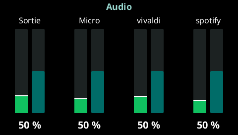<br>🔊 **Page Audio** : nom, VU-mètre et volume de 4 cibles | 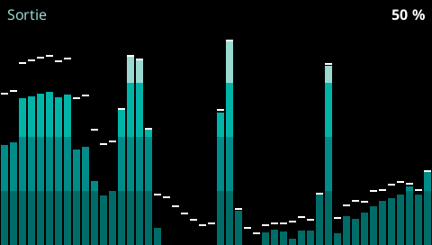<br>📈 **Visualiseur** : analyseur de spectre |
| 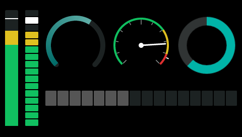<br>🎚️ **Jauges** : barre, segments LED, arc, aiguille, anneau, crans | 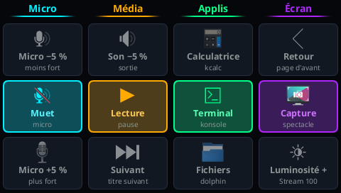<br>🟦 **Stream deck** : 4 pistes de cases, une par molette |
| 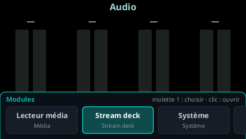<br>🧩 **Menu des modules** (maintien de la molette 1) | 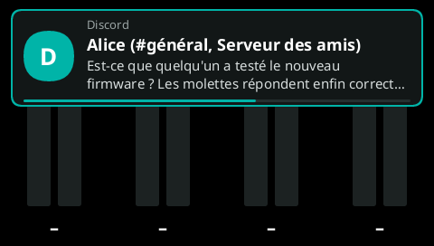<br>🔔 **Notification du bureau** (Discord) |
| 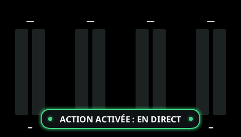<br>💊 **Pilule** : court bandeau animé | 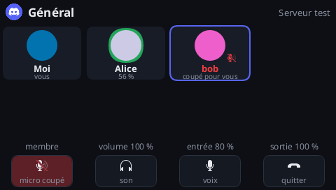<br>🎧 **Discord** : salon vocal, micro, volumes |
| 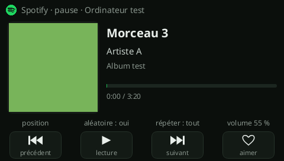<br>🎶 **Spotify** : morceau, pochette, commandes | 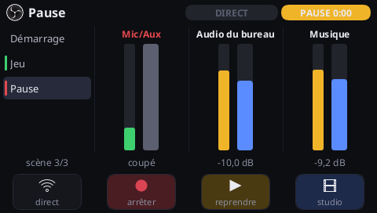<br>🎬 **OBS** : scènes, mixeur et vumètres, direct / enregistrement |
| 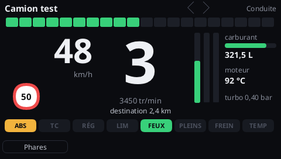<br>🏎️ **Motor Town** : écran conduite | 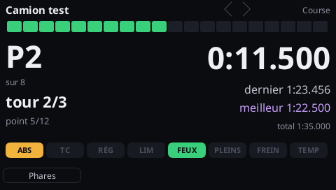<br>🏁 **Motor Town** : écran course |
| 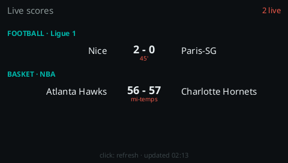<br>⚽ **Scores en direct** : les matchs en cours, par sport | 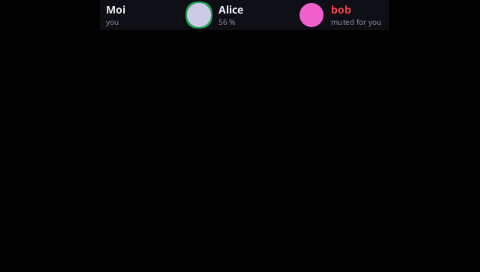<br>🎧 **Widget Discord** en ligne, qui défile de gauche à droite dans une bande de 30 px |
| 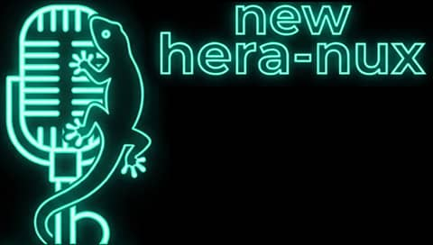<br>🚀 **Logo de démarrage** du firmware custom | 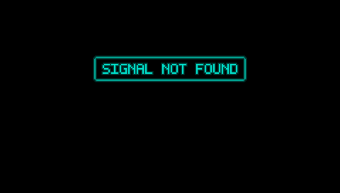<br>🛰️ **SIGNAL NOT FOUND** : l'économiseur du firmware custom quand l'ordinateur s'arrête (rétroéclairage à 1 % sur l'appareil) |

## ✨ Fonctionnalités

### 🖥️ L'app : New Hera-nux
- **Pages de widgets libres** : textes (variables, dégradés, défilement automatique quand ils sont
  trop longs), rectangles, images (PNG, JPEG…), icônes du thème du bureau, séparateurs (plein,
  tirets, points, fondu), cadres aux bords choisis, VU-mètres et jauges de volume (barre, segments
  LED, arc, aiguille, images personnalisées), analyseur de spectre (FFT), pages et widgets de
  modules, pistes de stream deck.
- **Fonds de page** : couleur, dégradé, image ou GIF animé, avec assombrissement.
- **Fenêtre d'édition en direct** : aperçu de l'écran de l'appareil, déplacement et redimensionnement
  à la souris, grille de 16 px et aimants, sélection multiple, aligner / répartir, déplacements au
  clavier, annuler / rétablir, enregistrement par Ctrl+S.
- **Étalonnage des couleurs** avec une mire, luminosité, [veille](#-veille).
- **Anglais ou français** (onglet Appareil), par des fichiers de traduction : une langue s'ajoute
  sans recompiler, et les modules suivent avec leurs propres fichiers. 🌍
- **Emoji en couleur**, polices du système, icône dans la barre système, instance unique, mode sans
  fenêtre (service), `--snapshot` pour rendre une page en PNG sans l'appareil.

### 🔊 Audio et médias
- **Cibles audio** par molette : sortie par défaut, entrée par défaut, n'importe quelle sortie ou
  entrée, **n'importe quelle application** (Firefox, Spotify, un jeu…), **l'application en plein
  écran** (jeux), ou une commande de module.
- Volume et sourdine par **PipeWire** (API PulseAudio), vumètres en direct à 60 Hz.
- **Lecteurs média** (MPRIS) : lecture / pause, suivant, précédent, position.

### 🎛️ Molettes, boutons et LEDs
- Chaque rotation et clic de molette, chaque **appui, maintien et clic** de bouton (power compris)
  peut lancer une **action** : sourdine, commande shell, ouvrir une adresse web, **raccourci
  clavier** (clavier virtuel), contrôle média, page suivante / précédente / choisie, afficher un
  module, **menu des modules**, commande de module, retour, luminosité (cycle, valeur, plus, moins).
- Sensibilité des molettes, délais de maintien, confirmation au-delà de 100 % de volume.
- **LEDs** : éteinte, allumée, selon une sourdine, ou selon l'état d'une commande de module.

### 🔔 Notifications
- **Notifications du bureau** (D-Bus) affichées sur l'appareil, filtrées par application, avec
  avatar et emoji ; un clic les ferme.
- **Alertes** et **pilules** animées venant des modules ou du terminal (`hsm01ctl alert …`) ; une
  seule par application dans la file.

### 💤 Veille
- **Écran en veille** après un moment sans action (5 minutes par défaut, réglable dans l'onglet
  **Appareil**) : le rétroéclairage baisse en fondu, puis l'écran et les LEDs s'éteignent.
- **Réveil** par n'importe quelle molette ou bouton (ce premier geste ne déclenche pas son action),
  ou par une notification si vous le voulez.
- **Pas de veille pendant un module** : chaque module a une case « pas de veille quand il est
  affiché » (OBS pendant un direct, un tableau de bord de jeu…) : l'écran reste allumé tant que sa
  page ou un de ses widgets est affiché, et la veille revient sur les autres pages.
- **App fermée** (Quitter, fin de session, extinction du PC) : l'appareil s'éteint proprement.
- **PC en veille** (firmware custom) : l'écran et les LEDs s'éteignent avec lui, et se rallument
  au réveil.
- **App plantée ou absente** (firmware custom) : l'économiseur « SIGNAL NOT FOUND » à 1 % de
  rétroéclairage, puis l'écran s'éteint au bout de 5 minutes. 🛰️

### 🔌 API ouverte
- Socket Unix et **WebSocket local** à jeton (utilisable par une page web), messages JSON.
- Pages, widgets, alertes, pilules, LEDs, événements des entrées, prise des entrées, commandes,
  listes des formulaires de réglages, contrôle média ; **client Python** fourni, tout langage
  possible.

### ⚙️ Firmware custom (240.xx)
- Écran libre 480×272 : remplir, copier une image, image compressée (RLE), **déplacer** (défilement
  matériel), environ **936 Kio/s** en USB bulk.
- Lectures brutes des deux curseurs des molettes toutes les 10 ms, boutons, rétroéclairage et LEDs
  de **0 à 100 %** (PWM).
- **Logo de démarrage** animé, économiseur **« SIGNAL NOT FOUND »** quand l'ordinateur s'arrête,
  puis écran éteint.
- **Trappe de secours DFU** en premier (requête USB ou clics molettes 1 + 4) ; la dernière page de
  la flash (numéro de série) n'est jamais touchée.

### 🦀 Drivers (Rust et C)
- **Tout le protocole d'origine** : trames et CRC16, toutes les commandes, icônes et libellés en RLE,
  VU-mètres, LEDs, fonds en 256 couleurs (mêmes résultats en Rust et en C), logo de démarrage,
  reports d'entrée.
- Le protocole du firmware custom.
- Outils en ligne de commande `hsm01` / `hsm01-c` : `info`, `monitor`, `demo`, `brightness`, `led`,
  `background`, `splash`, `fw …` (images PNG, JPEG, GIF, BMP).
- Tests sur des trames capturées, publications GitHub pour x86_64 et aarch64, règle udev.

## 🧩 Modules

Les modules sont de petits programmes qui enrichissent New Hera-nux. Chacun est un dossier de
`~/.local/share/hsm01/modules/` avec un `module.toml` et son programme, écrit en **Python**
(bibliothèque cliente fournie) ou dans **n'importe quel langage** qui parle JSON sur un socket
Unix. Par l'API ouverte, un module peut :

- 🖼️ dessiner ses propres **pages** et **widgets** sur l'appareil, et les mettre à jour en direct ;
- 🎛️ réagir aux **molettes et boutons**, et proposer des **commandes** à lier à n'importe quel
  bouton ou molette ;
- 🔔 afficher des **alertes** et des **pilules** (courts bandeaux animés) ;
- ⚙️ avoir son propre **formulaire de réglages** dans la fenêtre, et garder ses **données
  sensibles** (jetons, mots de passe) dans son propre fichier `.env`, lisible par vous seul.

L'app lance les modules que vous allumez, et les relance s'ils s'arrêtent, ou quand leur code,
leurs réglages ou la langue de l'app changent. 🔄

### 📋 Modules livrés

Fournis officiellement, dans [`app/modules/`](app/modules/) :

| Module | Ce qu'il fait |
|--------|---------------|
| 🎵 Lecteur média | pochette, titre, artiste, avancement du lecteur en cours ; commandes ; alerte au changement de morceau |
| 🌡️ Système | processeur, mémoire, températures, disques, batteries ; alertes avec seuils et durées |
| 📋 Menu de raccourcis | une grille de raccourcis sur l'écran |
| 🟦 Stream deck | 4 pistes de cases sans fin, une par molette |
| 🎧 Discord | micro, mode sourd, volumes, membres du salon vocal (avatars, qui parle), salons favoris, volume par membre, pilules « a rejoint le salon », widget des membres (en colonne ou en ligne) |
| 🎶 Spotify | pochette, j'aime, aléatoire, répétition, volume, radio du titre, listes favorites, boutons et clics de molettes réglables |
| 🎬 OBS | scènes, mixeur audio et vumètres sur les molettes, direct / enregistrement (arrêt en maintenant), replay, caméra virtuelle, mode studio, sources / filtres / médias favoris, widget « État d'OBS » |
| 🏎️ Motor Town, SimHub | tableau de bord de jeu (régime, rapport, vitesse, pédales, carburant, températures, voyants), écrans course et véhicule, LEDs compte-tours, pilules, relais des paquets |
| ⚽ Scores en direct | les matchs en cours du direct de L'Équipe, par sport et compétition ; filtre par sport, compétition, équipe ; lu toutes les minutes tant qu'un match du filtre est en cours, sinon toutes les 5 minutes ; page, widget, pilule quand un score change |

### 🛠️ Créer le vôtre

En un clic : onglet **Modules** → « Créer un module » donne un modèle prêt à modifier (une page,
un compteur sur la molette 1, une alerte sur le bouton 1, deux commandes, ses textes en anglais
et en français). Tout ce qu'un module peut faire est dans le guide de la bibliothèque Python
qu'ils utilisent tous, [`app/clients/python/README_FR.md`](app/clients/python/README_FR.md) :
pages et widgets, molettes et boutons, alertes, commandes, formulaire de réglages, données
sensibles, traductions, aides toutes faites, tests. N'importe quel autre langage marche aussi :
un module parle en lignes JSON sur un socket Unix ([`docs/app/api.md`](docs/app/api.md)), et
[`docs/app/modules.md`](docs/app/modules.md) détaille le dossier d'un module.

> ⚠️ **Les modules venus d'ailleurs.** Un module est un programme ordinaire qui tourne avec **vos**
> droits : il peut lire et écrire vos fichiers, utiliser le réseau, envoyer des frappes clavier par
> l'app… N'installez que des modules de confiance, et lisez leur code avant. 🔍 **Je ne suis pas
> responsable de ce que fait ou provoque un module qui n'est pas fourni officiellement** avec
> New Hera-nux (c'est-à-dire absent de `app/modules/` de ce dépôt).

## 📦 Installation

> ⏱️ Environ 15 minutes. Suivez les étapes **dans l'ordre**, depuis la racine du dépôt, et ne
> **sautez jamais la sauvegarde** 💾 : c'est votre seul moyen de revenir au firmware d'origine.

### 1. 🧰 Prérequis

```sh
# Debian / Ubuntu
sudo apt install build-essential pkg-config libusb-1.0-0-dev libpulse-dev llvm dfu-util python3-usb cmake
# Arch / Manjaro
sudo pacman -S base-devel pkgconf libusb libpulse llvm dfu-util python-pyusb cmake
# Rust (https://rustup.rs) et la cible du microcontrôleur de l'appareil
rustup target add thumbv7em-none-eabihf
```

### 2. 🔑 Accès sans root

La règle couvre l'appareil et son mode DFU (`0483:df11`) : rien de ce qui suit n'a besoin de `sudo`.
```sh
sudo cp packaging/udev/70-hercules-stream100.rules /etc/udev/rules.d/
sudo udevadm control --reload && sudo udevadm trigger
```
Puis débranchez et rebranchez le Stream 100. 🔌

### 3. 💾 Sauvegarder le firmware d'origine (à ne pas sauter !)

Rien n'est écrit dans l'appareil ici : tout est **lu**. Le microcontrôleur a un **bootloader DFU en
ROM** (de ST, impossible à effacer) ; la sauvegarde passe par lui.
```sh
mkdir -p backups/original && cd backups/original

# a. redémarrer le Stream 100 dans son bootloader DFU
python3 -I ../../tools/hsm01_dfu_enter.py --yes      # ou : maintenir les clics molettes 1 + 4 en le branchant
dfu-util -l                                           # doit lister 0483:df11

# b. vérifier que la flash peut être lue (niveau de protection)
dfu-util -d 0483:df11 -a 1 -s 0x1FF00000:64 -U ob_bank1.bin
dfu-util -d 0483:df11 -a 1 -s 0x1FF01000:64 -U ob_bank2.bin
python3 -I ../../tools/re/stm32l4_ob.py ob_bank1.bin ob_bank2.bin   # doit afficher « -> level 0 »

# c. lire toute la flash (2 Mio) et la zone OTP
dfu-util -d 0483:df11 -a 0 -s 0x08000000:0x200000 -U flash_full_backup.bin
dfu-util -d 0483:df11 -a 2 -s 0x1FFF7000:1024 -U otp.bin

# d. le fichier de restauration (début de la flash, couvre tout firmware custom) + sommes de contrôle
head -c 262144 flash_full_backup.bin > restore_first_256k.bin
sha256sum *.bin | tee backup.sha256
cd ../..
```
- 🛑 Si l'étape **b** n'affiche pas `level 0`, **arrêtez-vous** : la flash est protégée et ne peut
  pas être sauvegardée.
- 🗂️ Gardez des **copies** de `backups/original/` ailleurs (clé USB, autre disque), et vérifiez-les
  plus tard avec `sha256sum -c backup.sha256`.
- 🔒 La sauvegarde contient le **numéro de série** de l'appareil : gardez-la pour vous (`backups/`
  est ignoré par git).
- `dfu-util -U` refuse d'écraser un fichier : supprimez l'ancien avant de relancer.

### 4. ⚙️ Compiler et flasher le firmware custom

```sh
cd firmware/rust && cargo build --release
llvm-objcopy -O binary target/thumbv7em-none-eabihf/release/hsm01-fw hsm01-fw.bin
python3 -I ../../tools/re/fw_hatch_check.py target/thumbv7em-none-eabihf/release/hsm01-fw   # tout « OK »
cd ../..

python3 -I tools/hsm01_dfu_enter.py --yes            # si l'appareil n'est plus en mode DFU
dfu-util -d 0483:df11 -a 0 -s 0x08000000 -D firmware/rust/hsm01-fw.bin
rm -f readback.bin                                     # relire et comparer
dfu-util -d 0483:df11 -a 0 -s 0x08000000:$(stat -c %s firmware/rust/hsm01-fw.bin) -U readback.bin
cmp firmware/rust/hsm01-fw.bin readback.bin && echo "RELECTURE OK"
dfu-util -d 0483:df11 -a 0 -s 0x08000000:leave       # démarrer le nouveau firmware
python3 -I tools/hsm01_whoami.py                       # doit afficher « 240.xx -> custom firmware »
```
`fw_hatch_check.py` vérifie que la trappe de secours DFU s'exécute en premier et que la dernière
page de la flash n'est pas touchée : ne flashez jamais une compilation qui ne passe pas ce contrôle.

### 5. 🖥️ Compiler et lancer New Hera-nux

```sh
cd app && cargo build --release
./target/release/hsm01-app            # fenêtre + appareil
./target/release/hsm01-app --headless # sans fenêtre, en service
```
Au premier lancement, la configuration est créée dans `~/.config/hsm01/config.toml` et les modules
livrés sont copiés dans `~/.local/share/hsm01/modules/` : allumez-les dans l'onglet **Modules**. 🧩

### 6. ↩️ Revenir au firmware d'origine (à tout moment)

```sh
python3 -I tools/hsm01_dfu_enter.py --yes            # ou maintenir les clics molettes 1 + 4 en le branchant
dfu-util -d 0483:df11 -a 0 -s 0x08000000:leave -D backups/original/restore_first_256k.bin
python3 -I tools/hsm01_whoami.py                       # « -> official firmware »
```

### ⛔ Jamais

- **n'écrivez jamais `-a 1`** (option bytes) : un mauvais octet peut verrouiller la puce **pour
  toujours** (plus de DFU, plus de débogage, irréversible) ;
- **n'effacez ni n'écrivez jamais la dernière page de la flash** (`0x081FF000`, numéro de série et
  réglages) : pas d'effacement complet, pas d'écriture de la flash entière ;
- **ne débranchez jamais** l'appareil pendant une écriture. En cas de problème, le bootloader ROM
  est toujours là : maintenez les clics molettes 1 + 4 en le branchant, et restaurez.

### 🦀 Les pilotes seuls (facultatif)

```sh
cd driver/rust && cargo build --release        # hsm01 info | monitor | demo | background | splash | fw …
cmake -S driver/c -B driver/c/build && cmake --build driver/c/build   # hsm01-c, mêmes commandes
```

## 📁 Organisation du dépôt

| Dossier | Contenu |
|---------|---------|
| [`app/`](app/) | **New Hera-nux** : l'application compagnon (`hsm01-app`, Rust + egui), `hsm01ctl`, les modules livrés ([`app/modules/`](app/modules/)) |
| [`app/clients/python/`](app/clients/python/) | `hsm01`, la bibliothèque Python des modules, et [son guide](app/clients/python/README_FR.md) |
| [`driver/rust/`](driver/rust/) | pilotes Rust : `hsm01-proto` (protocole, sans entrées-sorties), `hsm01-usb` (libusb), outil `hsm01` |
| [`driver/c/`](driver/c/) | portage C11 des pilotes et de l'outil (`hsm01-c`), CMake |
| [`firmware/`](firmware/) | le firmware custom (`rust/` : embassy, STM32L4R7) et les tests de son parseur sur l'ordinateur (`proto-tests/`) |
| [`docs/`](docs/README.md) | tout : protocole, rétro-ingénierie, firmware, app, API, modules |
| [`explanation/`](explanation/00-sommaire.md) | tout le parcours pas à pas : recherches, explications et commandes |
| [`tools/`](tools/) | scripts de test et de rétro-ingénierie, faux serveurs des tests de bout en bout, vérification des traductions |
| [`packaging/udev/`](packaging/udev/) | règle udev pour l'accès sans root |
| [`.github/workflows/`](.github/workflows/) | intégration continue : firmware et app (`build.yml`), pilotes Rust et C (`release-rust.yml`, `release-c.yml`) |

## 📊 État du projet

- ✅ Protocole du firmware d'origine entièrement décodé (commandes, entrées, fond, logo de démarrage).
- ✅ Pilotes Rust et C à parité, testés avec gcc / clang en `-Werror`.
- ✅ Firmware custom en service sur l'appareil : écran libre, défilement, molettes brutes, LEDs, économiseur.
- ✅ New Hera-nux : pages, éditeur, mixeur audio, notifications, veille, API, modules (Discord,
  Spotify, OBS, Motor Town, SimHub, scores en direct, système…).
- ✅ Anglais et français, pour l'app et les modules, par des fichiers de traduction.
- ✅ Intégration continue : firmware et app compilés et testés sur GitHub à chaque envoi ;
  publications sur les tags (`fw-v…`, `app-v…`, `rust-v…`, `c-v…`).
- 🔜 Faire tourner l'app sur le firmware d'origine (étude faite, pas encore codé).

## 📖 Les coulisses du projet

Pourquoi ce projet existe, comment il a été fait, et ce qui a coincé en chemin.

### 🔧 Pourquoi un firmware custom

**Pourquoi ne pas juste refaire la communication du logiciel d'origine ?** 🤔 C'était la première
étape, et elle marche : les drivers Rust et C parlent entièrement le protocole d'origine (icônes,
libellés, VU-mètres, LEDs, images de fond, logo de démarrage : essayez `hsm01 demo`). Mais refaire
la communication ne redonne **que ce que faisait déjà le logiciel Windows**, car avec le firmware
d'origine, c'est le **firmware**, pas l'ordinateur, qui décide de ce qui apparaît à l'écran.

Le firmware d'origine (1.40 / 1.42) n'est pas un écran sur lequel on dessine : il compose
l'affichage **lui-même**, dans une **disposition fixe de 4 colonnes** (deux barres VU, une icône
32×32 et un libellé 110×16 par colonne) sur un fond. Quoi que l'ordinateur envoie, il ne peut que
remplir ces cases. C'est tout ce qu'en fait le logiciel Windows, et ce n'était pas assez pour ce
qu'on voulait faire. 🚧

| | Firmware d'origine | Firmware custom (240.xx) |
|---|---|---|
| Dessin | disposition fixe : 4 icônes, 4 libellés, 8 barres VU | **écran libre** : remplir, copier une image, image compressée, déplacer (défilement) n'importe où |
| Fond | image 256 couleurs, **~1,3 s** à envoyer, pas de mise à jour partielle | redessiné **à 60 images/s**, seulement les tuiles 16×16 modifiées |
| Débit | isochrone, petits messages | bulk, **~936 Kio/s** |
| Textes, menus, animations | seulement cuits dans des images | tout ce que l'app sait dessiner 🎨 |
| Molettes | compteurs déjà décodés | lectures brutes des deux curseurs, décodées par l'hôte (512 pas par tour) |
| LEDs, rétroéclairage | allumé / éteint / clignote, intensité commune | **0-100 %** chacune, veille en fondu |
| Bouton power | agit tout seul (luminosité, écran éteint) | entièrement à l'app |
| Hôte absent | ses propres écrans de démonstration | économiseur « SIGNAL NOT FOUND », puis écran éteint 💤 |

En bref, un nouveau firmware était le seul moyen d'avoir :

- 🖌️ **la liberté** : le firmware d'origine ne sait montrer que ce qu'Hercules a prévu ; le custom
  laisse l'app montrer **tout** (pages libres, menus, alertes, pages de modules en plein écran) ;
- ⚡ **la vitesse** : une image de fond prend plus d'une seconde sur le firmware d'origine, et le
  moindre changement oblige à la renvoyer entière ; le custom ne met à jour que ce qui change,
  60 fois par seconde ;
- 🎮 **le contrôle** : plus de bouton power qui agit tout seul, LEDs et rétroéclairage à n'importe
  quel niveau, lectures brutes des molettes ;
- 🎓 **l'apprentissage** : après le driver (le côté ordinateur du câble USB), le firmware est
  l'autre côté ; l'écrire a demandé de comprendre le microcontrôleur lui-même (contrôleur d'écran,
  ADC, PWM, USB), la suite logique d'un projet pour apprendre.

Et rien n'est perdu ↩️ : le protocole d'origine reste entièrement géré par les drivers, et le
firmware d'origine peut être remis à tout moment.

🛡️ **La sécurité d'abord.** Le firmware custom garde une **trappe de secours DFU** en tout premier
(requête USB, ou clics molettes 1 + 4), ne touche jamais la dernière page de la flash (où vit le
numéro de série), n'écrit jamais les « option bytes », et le firmware d'origine peut être remis à
tout moment depuis une sauvegarde avec `dfu-util`. Une étude pour faire tourner l'app sur le
firmware d'origine est dans [`docs/app/firmware-officiel.md`](docs/app/firmware-officiel.md).

### 🎓 Un projet pour apprendre

C'est avant tout un projet pour **apprendre à faire un driver** 🧑‍🔧 : partir d'un appareil USB
inconnu, sans schéma ni documentation, comprendre comment il fonctionne (captures USB, Ghidra sur
le logiciel d'origine, son driver Windows et son firmware), reconstruire son protocole, puis
écrire des drivers pour lui parler depuis Linux, en Rust et en C. En chemin, le projet est allé
plus loin que prévu : sauvegarde et restauration de l'appareil, une application compagnon, et même
un firmware à lui, écrit de zéro et débogué sur le vrai matériel. 🚀

📖 **Toutes mes recherches et explications** sont dans [`explanation/`](explanation/00-sommaire.md) :
les outils, l'installeur et ses binaires, Ghidra, les captures USB, le protocole et le firmware
d'origine, la sauvegarde et la restauration en DFU, les pilotes Linux, le firmware custom, son
débogage, les molettes, le logo de démarrage et les couleurs, et un aide-mémoire. Chaque étape
donne les commandes pour la refaire soi-même. 🔁

### 🪤 Les pièges dans lesquels on est tombés

Rien n'a marché du premier coup. 😅 Voici les pièges les plus marquants et ce qu'ils ont appris ;
le détail (versions, mesures, commandes) est dans [`docs/firmware/stage2.md`](docs/firmware/stage2.md)
et [`explanation/10-debogage-firmware.md`](explanation/10-debogage-firmware.md).

#### 👻 L'image fantôme (rémanence)

- **Symptôme** : avec les premières versions du firmware custom (240.01 à 240.12), une image fixe
  « marquait » la dalle en **2 à 3 minutes** (logo, grille), des lignes apparaissaient dans les
  aplats, et de vieux fantômes (le logo Hercules, des mois d'usage) remontaient.
- **Fausses pistes** : une dalle fragile, une broche de l'écran, la vitesse des sorties. Un **test
  A/B** avec le firmware d'origine (damier pendant 3 minutes, puis gris) n'a laissé **aucun
  fantôme** : la dalle allait bien, c'était notre façon de la piloter. Indice décisif : avec les
  sorties réglées comme l'officiel, plus d'image du tout. Incohérent… sauf si notre horloge était
  trop rapide.
- **Cause** : l'horloge pixel tournait **4 fois trop vite** (40 MHz et 252 images/s au lieu de
  10 MHz et 63 images/s). Son diviseur n'est modifiable que PLL arrêtée : notre réglage était
  ignoré, sans la moindre erreur.
- **Correctif** (240.13) : arrêter la PLL, écrire le diviseur, la relancer ; vérifié en relisant
  le registre par une requête USB de diagnostic (`tools/fw_regs.py` → 10 MHz, 63,1 Hz). Damier de
  3 minutes : plus aucun fantôme. Ceux laissés par les versions à 40 MHz s'estompent avec le temps.
- **Depuis** : sans ordinateur, rien ne reste immobile à l'écran : le logo laisse place au noir au
  bout de 10 s, puis l'économiseur bouge sans arrêt à 1 % de rétroéclairage, et l'écran s'éteint
  au bout de 5 minutes.

#### 🎨 Les couleurs de la dalle (étalonnage)

- **Symptôme** : le vert du logo, repris de l'image d'origine (#00674F, pensé pour un fond blanc),
  sortait **« vert fluo »** sur l'appareil (240.16), et les teintes sombres viraient au gris. Une
  couleur juste sur l'écran du PC ne l'est pas forcément sur celui du Stream 100.
- **Cause** : une petite dalle rétroéclairée, sur fond noir, en RGB565 (32 niveaux de rouge et de
  bleu, 64 de vert), ne rend ni comme un écran d'ordinateur ni comme une impression.
- **Correctifs** :
  - pour le firmware, la couleur se choisit **sur l'appareil, à l'œil** : des pastilles affichées
    par `tools/fw_swatches.py`, en resserrant à chaque tour (trop vert → plus bleu → trop bleu →
    entre les deux → trop sombre → échelle de luminosité) jusqu'à **#006C68** (240.17) ;
  - pour l'app, un **étalonnage des couleurs** : gain (balance des blancs) et gamma (tons moyens)
    pour chaque canal rouge, vert et bleu, réglés avec une **mire** affichée sur l'appareil à côté
    de la même mire non corrigée dans la fenêtre, et appliqués à tout ce qui part vers l'écran.
- **Limite** : le logo de démarrage, qui vit dans le firmware, n'est pas corrigé par l'étalonnage.

#### ⚙️ Côté firmware

- 🔀 **L'image cisaillée** (240.06) : chaque ligne décalée de 2 pixels par rapport à la
  précédente. La bibliothèque réglait la longueur de ligne du contrôleur d'écran à « octets + 7 »,
  ce microcontrôleur attend « + 3 » (lu dans le firmware d'origine). Ces restes d'image avaient
  d'abord été pris pour de la rémanence. Mire de contrôle : `tools/fw_geometry.py`.
- 🧊 **Gelé avant l'USB** (240.02) : logo affiché, mais rien sur le bus. L'ADC n'avait pas
  d'horloge, et sa calibration attendait un bit qui ne bascule jamais. Récupéré par la trappe
  molettes 1 + 4 : la preuve qu'elle doit s'exécuter **avant tout le reste**.
- ⏳ **Un quartz qui n'existe pas** (240.05) : un quartz 32 kHz activé « comme l'officiel »…
  que l'officiel n'allume pas. Le firmware l'attendait pour toujours. Leçon : lire les **valeurs
  réelles** données aux fonctions, pas seulement leur nom.
- 🐢 **USB 4 fois trop lent** : 250 Kio/s, soit exactement 4 paquets par milliseconde. Le pilote
  USB de la bibliothèque n'acceptait qu'un paquet à la fois ; une copie corrigée (anneau de
  16 paquets) puis un décodeur plus rapide donnent **936 Kio/s**, près du maximum de l'USB Full
  Speed. Surprise au passage : le débit dépend des pixels (le blanc et le vert pur descendent à
  625 Kio/s, à cause du bourrage de bits de l'USB).
- 🥶 **Les molettes qui ne répondent plus** : sous forte charge, la réception USB ne rendait
  jamais la main et plus aucun rapport d'entrée ne partait (corrigé en 240.18 et 240.19) ; après
  des heures, un rapport jamais lu par l'ordinateur bloquait les entrées pour de bon (corrigé en
  240.20 : délai de 250 ms et remise à zéro de l'endpoint). Côté app, lire les rapports depuis la
  boucle d'affichage en perdait 4 sur 5 : ils sont maintenant lus par un fil dédié.

#### 🔌 Côté appareil et logiciel d'origine

- 🍷 **Wine et Proton** : le logiciel d'origine parle à des drivers **noyau** Windows que Wine ne
  charge pas. Impossible de s'en servir sous Linux, même pour mettre à jour le firmware.
- 💓 **Un ordinateur qui se tait** : le firmware d'origine éteint l'écran ou abandonne l'ordinateur
  si celui-ci n'envoie pas la luminosité et ne lit pas les rapports d'entrée ; un keep-alive seul
  ne suffit pas.
- 🌀 **Un clic qui fait tourner** : cliquer une molette la fait souvent tourner de 1 à 4 pas ; il
  faut filtrer ces faux mouvements.

#### 🧩 Côté modules

- 🎶 **Spotify a changé son API en 2026** : « J'aime » et les listes de lecture ont changé
  d'adresse (les anciennes répondent 403), les commandes du lecteur répondent du texte au lieu de
  JSON, et la répétition est refusée (« Restriction violated ») quand rien n'est en contexte.
- 🎧 **Discord** répond « Missing redirect_uri » si l'application n'a pas **exactement une**
  adresse de redirection enregistrée.
- 🏎️ **Motor Town** : `0.0.0.0` est une adresse d'écoute, pas une destination ; le jeu doit envoyer
  sa télémétrie à `127.0.0.1`.

#### 💡 Ce qu'on en retient

- **Mesurer plutôt que supposer** : débit, registres, captures USB.
- Quand un réglage « devrait » être bon, **relire le registre**.
- Un **test A/B** contre le firmware d'origine tranche entre matériel et logiciel.
- La **trappe de secours** passe en premier, toujours. 🛟
- Une couleur se juge **sur l'appareil**, pas sur l'écran du PC.

### 🏛️ Le nom

Pourquoi **New Hera-nux** ?

- **Hera** ➜ de **Héraclès**, le nom d'origine d'**Hercule** 💪
- **-nux** ➜ de **Linux** 🐧
- **New** ➜ pour un nouveau départ du Stream 100, cette fois sous Linux ✨

## ⚖️ Mentions légales

- 🎯 **But : l'interopérabilité.** La rétro-ingénierie (captures USB, décompilation du logiciel
  d'origine, de son driver Windows et du firmware de l'appareil avec Ghidra) a été faite pour une
  seule raison : faire fonctionner un appareil que je possède sur un système que son fabricant ne
  prend pas en charge. Elle entend rester dans l'exception d'interopérabilité de la directive
  européenne sur les programmes d'ordinateur (2009/24/CE, article 6), article L122-6-1 du Code de
  la propriété intellectuelle.
- 🚫 **Rien d'Hercules n'est distribué ici** : ni code, ni firmware, ni driver, ni installeur, ni
  listing décompilé, ni image, police ou icône d'Hercules / Guillemot. Les drivers, l'app et le
  firmware custom sont un travail indépendant, écrit de zéro. Les sorties de décompilation et les
  fichiers officiels restent sur mon ordinateur et ne sont pas publiés ; le guide explique comment
  obtenir soi-même les fichiers officiels, auprès d'Hercules.
- 📝 La documentation décrit, avec mes propres mots, le comportement de l'appareil (protocole,
  commandes, matériel) pour qu'un logiciel indépendant puisse lui parler ; elle ne reproduit pas de
  code officiel.
- 🛠️ Installer un firmware custom peut **annuler la garantie**, et se fait à vos risques.
- 📬 **Ayants droit :** si Hercules / Guillemot estiment que quelque chose ici porte atteinte à leurs
  droits, ouvrez une issue : ce sera examiné et corrigé de bonne foi.

## ⚠️ Avertissement

Projet indépendant : ni affilié à Hercules / Guillemot, ni approuvé ou soutenu par eux.
« Hercules » et « Stream 100 » sont leurs marques. Flasher un firmware se fait **à vos risques** :
sauvegardez d'abord. Les sauvegardes de l'appareil contiennent son numéro de série : gardez-les
pour vous. Les modules qui ne sont pas livrés dans `app/modules/` sont sous la seule
responsabilité de leurs auteurs et de ceux qui les installent : je ne suis pas responsable des
dégâts qu'ils pourraient causer.

---

Fait avec 💙 pour un petit appareil qui méritait mieux qu'un tiroir. 🎛️🐧
